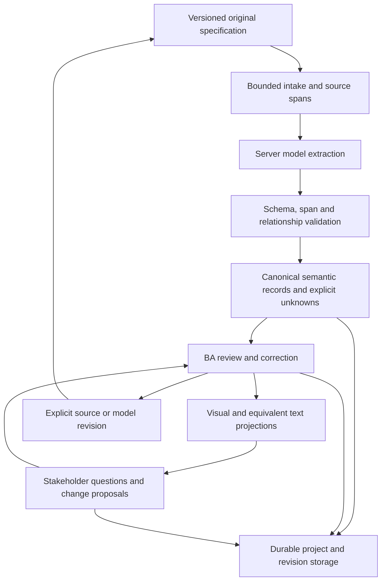

# Major revision 1 execution roadmap

Plan version: **MR-1 plan 1.0**. Recorded **2026-11-23**, Europe/Helsinki.
Status: **planning delivered for review; implementation sprints MR-01 through MR-14 are planned**.
Target: **1.0.0 research prototype**. The target number describes a new product contract, not commercial maturity or completed research.

Tracking: [MR-1 parent issue #10](https://github.com/alikhalessi/Visual-SDD-Canvas-GPT/issues/10). All fourteen sprint issues are linked from the [micro sprint contracts](MICRO_SPRINTS.md).

## Product and research contract

Visual SDD will receive an existing software specification, propose a source-grounded semantic model, allow a business analyst (BA) to correct it, and present linked visual views for stakeholder review. Stakeholder questions and proposed changes return to the same versioned source/model. The BA is a professional stakeholder and facilitator; developers contribute technical constraints; the appropriate business owner retains decision authority.

The first user journey is: **upload/paste specification → inspect source-grounded proposals → BA correction → visual/text inspection → stakeholder feedback → explicit proposed revision**. A pre-authored sample alone cannot complete this contract.

The primary proposed research question is whether traceable visualization, with comparable BA facilitation, improves stakeholder comprehension and identification/communication of ambiguities compared with equivalent structured text. Extraction fidelity and BA effort are evaluated separately. The revised English proposal is a deliverable of MR-01; supervisor/institutional approval is not inferred from engineering work.

## Existing baseline and version policy

| Artifact | Verified baseline on 2026-11-23 | Treatment |
| --- | --- | --- |
| Main / Sprint 10 | `561ca87f8c5ec17e4b731d5583f4f5b73fd0a02a` | Starting point of this branch; current application remains the baseline |
| Sprint 11 / PR #8 | `30d9a0a1799059ea03848e0116e0007a03f94b06`; open, unmerged | Reuse candidates for evaluation only after explicit path-level audit |
| Mini-sprint 11.1 / PR #9 | `a2c3e9488a1d0b3f814945f2200a6daf17243a2e`; open, unmerged, based on Sprint 11 | Reuse candidates for disclosure, sample/reset and isolated demo |
| Package version | 0.7.0 in the checked source | Unchanged by this planning PR |
| New workstream | `major-revision-1` from exact main above | Documentation now; feature branches and preview candidates later |

Historical plans and release evidence remain available in Git history and existing sprint documents. [Legacy roadmap at the pinned main revision](https://github.com/alikhalessi/Visual-SDD-Canvas-GPT/blob/561ca87f8c5ec17e4b731d5583f4f5b73fd0a02a/docs/ROADMAP.md).
PRs [#8](https://github.com/alikhalessi/Visual-SDD-Canvas-GPT/pull/8) and [#9](https://github.com/alikhalessi/Visual-SDD-Canvas-GPT/pull/9) are not merged, closed, rebased or implicitly accepted by this roadmap.

Feature branches use `mr-01-...` through `mr-14-...` and target `major-revision-1`; MR-01 enables CI for that PR base before application work is integrated. Each PR carries its requirement IDs, acceptance results and exact source revision. A code-complete sprint may advance after its evidence gate passes without repetitive permission requests. Main merge, production promotion, license grants, and research participation follow their actual authorization boundaries. This request authorizes preparing the roadmap and backlog; it is not a blanket production-release authorization.

## Scope of the first revised release

- UTF-8 English text/Markdown specifications by upload or paste, with declared input limits and preserved originals.
- Three-domain reference corpus; one generic pipeline across supported documents.
- One real model provider behind a server-only adapter; validated structured proposals, evidence spans, explicit inferences and unknowns.
- BA workbench, actor/behavior/decision/exception graph, equivalent text, source navigation and revision-bound decisions.
- Durable shared projects and asynchronous feedback from invited stakeholders with server-enforced permissions.
- Linked external prototypes and a small hypothesis/test/evidence record.
- Evaluation preparation, independent semantic references, a human formative pilot and an installable research artifact.

PDF/OCR, arbitrary Word layouts, every language, arbitrary-length documents, full BPMN/SysML coverage, generated executable applications, automatic market-fit conclusions, real-time co-editing, enterprise administration and a full empirical thesis study are separate scope proposals. Their effort is excluded from this estimate. The first language and format contract can change at MR-01, but a material change requires re-estimation before implementation.

## Proposed architecture

A source document is authoritative evidence, not an instruction to the model/agent. Exact source spans and content digests identify evidence, while semantic entailment still needs independent review. Origin (explicit/inferred/human-added) and decision state (proposed/accepted/rejected/unresolved/stale) are separate dimensions. Hypothetical background paths remain open questions unless supported and reviewed. Accepting an interpretation does not prove implemented software behavior.

The graph renderer consumes canonical records; it must not use per-sample hard-coded topology. Graph and text consume the same facts/states. No source/model record can be silently discarded merely because the selected diagram cannot show it. Prototype links and hypothesis records supplement review; market conclusions require actual evidence.

Existing v1 specification readers and user projects stay compatible through explicit adapters/versioned envelopes. MR-03–06 use recoverable local drafts for the first slice; complete cross-device collaboration is only claimed after MR-08 verifies the full persisted envelope and multi-user authorization. MCP is optional infrastructure; it is not a prerequisite for a model API call.

## Requirements and acceptance mapping

| ID | Owner need / invariant | Delivery | Observable acceptance |
| --- | --- | --- | --- |
| R-01 | Receive an existing specification rather than require manual reconstruction | MR-03, MR-06 | Fresh uploaded document completes the pipeline |
| R-02 | Generic pipeline across product domains | MR-02, MR-07 | Six documents / three domains; held-out results with no per-case code |
| R-03 | BA acts as professional mediator and reviewer | MR-05, MR-09, MR-13 | BA corrects proposals and resolves stakeholder concerns with evidence |
| R-04 | Real semantic extraction with an explicit model connection | MR-04 | Credentialed provider smoke and usage/model metadata |
| R-05 | Visualize behavior, decisions, exceptions and hidden timing paths | MR-06, MR-07 | Graph topology follows records; queued path positive/negative cases |
| R-06 | Preserve provenance, uncertainty and revision history | MR-03–09 | Exact spans, distinct origin/state, stale decisions and recoverable history |
| R-07 | Let a group review the same durable project | MR-08, MR-09 | Two independently authenticated users across fresh browser contexts |
| R-08 | Return feedback to specifications | MR-09 | Saved concern → BA disposition → explicit revision with impact |
| R-09 | Support prototype/need-validation evidence | MR-09 | External link plus hypothesis/test/metric/threshold/evidence state |
| R-10 | Evaluate comprehension fairly | MR-10, MR-13 | Equivalent facts/BA support, valid scoring, actual human pilot |
| R-11 | Inspectable demo and reset | MR-12 | Anonymous sample, exact reset, labeled sample/live modes |
| R-12 | Open-source research artifact | MR-14 | License/rights decision, notices, clean-checkout run and permitted materials |
| R-13 | Inspect every scenario and result later in GitHub | All | Versioned case definitions, named results, revision and durable evidence manifest |
| R-14 | Preserve current projects and release control | MR-01, MR-03, MR-08, MR-12 | Legacy compatibility; isolated previews; explicit main/production decision |

## Milestones and gates

| Gate | Required evidence | Decision |
| --- | --- | --- |
| G0 Definition ready, MR-01/02 | Input/output contract, revised proposal draft, corpus/split/rights, thresholds and reuse decisions | Start the generic extraction path; academic decisions remain separately recorded |
| G1 Extraction feasibility, MR-04 | Real provider execution, source-supported development results, error/cost/latency report | Continue, repair or narrow scope before investing in the full interface |
| G2 First vertical slice, MR-06 | A fresh supported document traverses the entire pipeline with real model extraction and traceable visual/text output | Demonstrable single-user prototype; collaboration remains future work |
| G3 Cross-domain fidelity, MR-07 | Frozen held-out benchmark and independent adjudicated references; raw and BA-corrected results | Accept supported scope or revise and re-test without tuning on held-out answers |
| G4 Shared review workflow, MR-09 | Complete persisted records, access tests, two-user feedback and revision loop | Shared pilot candidate |
| G5 Engineering candidate, MR-12 | MR-10/11 checks, exact preview revision, recovery/demo/manual and evidence | Engineering-ready candidate; no automatic research-effectiveness claim |
| G6 Human readiness, MR-13 | Actual BA/stakeholder sessions and bounded corrections after appropriate consent/research approval | Researcher/supervisor readiness decision |
| G7 Research artifact, MR-14 | Rights/license, reproducibility, acceptance matrix and authorized release record | Versioned public artifact after the required publication decision |

Initial engineering thresholds proposed for freeze at MR-01: at least 0.90 precision and 0.85 recall of annotated material facts/relationships on the bounded held-out corpus; separately report raw extraction and BA-corrected results. Every annotated critical behavior must be represented or explicitly flagged as unresolved, with zero unlabelled unsupported critical behavior in the reviewed export. Every displayed source link must validate. These are project acceptance targets, not literature-derived universal standards. List numerators, denominators, error types and document-level results; they do not establish broad generalization. If corpus/adjudication makes a threshold inappropriate, amend it transparently before the held-out run, not after seeing its answers.

A schema/span check cannot establish entailment. A passing browser check cannot establish stakeholder comprehension. A successful formative pilot cannot establish market fit or a statistically supported treatment effect.

## Execution order and estimates

The conservative single-engineer execution order is MR-01 through MR-14. Dependencies and full sprint contracts are in [Micro sprints](MICRO_SPRINTS.md); this order includes no assumed staffing/parallelization benefit. Corpus refinement and draft documentation may overlap only when their inputs are fixed.

The first vertical slice has a weighted estimate of **143.7 active hours**, or **172.4 hours including 20% reserve**.
The engineering candidate through MR-12 is **309.3 + 61.9 = 371.2 hours**.
The full bounded plan including formative pilot effort and research packaging is **342.7 + 68.5 = 411.2 hours**.

At an assumed **30 productive engineer hours/week**, the corresponding planning horizons are approximately **6**, **13** and **14** working weeks, plus external waiting. These are conditional planning estimates, not delivery guarantees or background-agent execution schedules. See [Estimate basis and scenarios](ESTIMATES.md) for all inputs, optimistic/pessimistic sums and exclusions.

Re-estimate after MR-04 and MR-06 using actual effort, provider results, BA correction load and measured remaining work. Re-estimate immediately for a new input format/language, additional model provider, changed collaboration requirements, a failed gate or scope growth greater than 20%. Keep the old estimate beside the new one with its reason.

## Dependencies and decision ownership

| Dependency | What must be resolved | Who prepares / decides | Gate affected |
| --- | --- | --- | --- |
| Provider access and spend | One live model route, account availability, budget and data-use terms | Implementer prepares verified options; owner authorizes paid access if needed | G1 |
| Supported inputs | English text/Markdown limits and representative source documents | Implementer drafts the contract from this scope; BA/owner reviews material changes | G0 |
| Independent reference | BA/domain reviewer availability and adjudicated annotations | Researcher coordinates an actual independent human reviewer | G0/G3 |
| Shared access policy | BA/editor/reviewer permissions and invitation lifecycle | Implementer specifies/tests; owner resolves only material policy choices | G4 |
| Human study | Supervisor direction, consent and applicable institutional requirements | Researcher/supervisor and intended participants | G6 |
| License and public materials | Software rights, dependency notices and sample/data permissions | Implementer prepares concrete license/rights record; owner makes the grant | G7 |

Connected GitHub/Vercel/Neon accounts do not prove the application has an operational model credential or an approved model budget. The existing optional GitHub coding-runner secret is not evidence of an application extraction integration. Report an actual access dependency when verified; do not request or print tokens in public issues.

## Preventing another alignment failure

Each sprint evidence record states: **what a user can now do; input/output; exact revision; automatic/live/human checks; what remains unsupported**. Every feature traces to R-01–R-14. Demonstrations distinguish prebuilt sample data, mock-provider tests and actual model calls.

Statuses are planned, in progress, verification pending, engineering done, human review pending, accepted, or blocked with a concrete dependency. Status changes require linked evidence. Engineering work can continue around a nondependent academic/recruitment wait; human-dependent gates cannot be simulated by the coding agent.

A requested change is assessed against the product contract, logged with impact on estimate/criteria and deliberately scheduled. New ideas do not silently replace the current sprint objective. Before every milestone, re-run the complete user journey against the original need, including a fresh document; test counts alone cannot satisfy it.

## Research and technical foundations

- [IIBA requirements and designs](https://www.iiba.org/knowledgehub/the-business-analysis-standard/4-implementing-business-analysis/4-4-understanding-requirements-and-designs/): trace needs, stakeholder requirements and solution records.
- [Model Generation with LLMs](https://arxiv.org/abs/2404.06371): prior work studies requirements-to-sequence-diagram generation and reports completeness/correctness challenges; novelty must be established by a focused literature review.
- [AI SDK structured data](https://ai-sdk.dev/docs/ai-sdk-core/generating-structured-data): a possible implementation mechanism; MR-04 checks installed-version documentation before choosing APIs.
- [Strategyzer Test Card](https://www.strategyzer.com/library/validate-your-ideas-with-the-test-card): hypothesis, experiment, measurement and threshold for optional validation records.
- [GitHub licensing guidance](https://docs.github.com/en/repositories/managing-your-repositorys-settings-and-features/customizing-your-repository/licensing-a-repository): a public repository needs an appropriate license to be offered as open source.

These sources motivate the design. They do not prove this project's scientific novelty, semantic reliability or measured usefulness.
